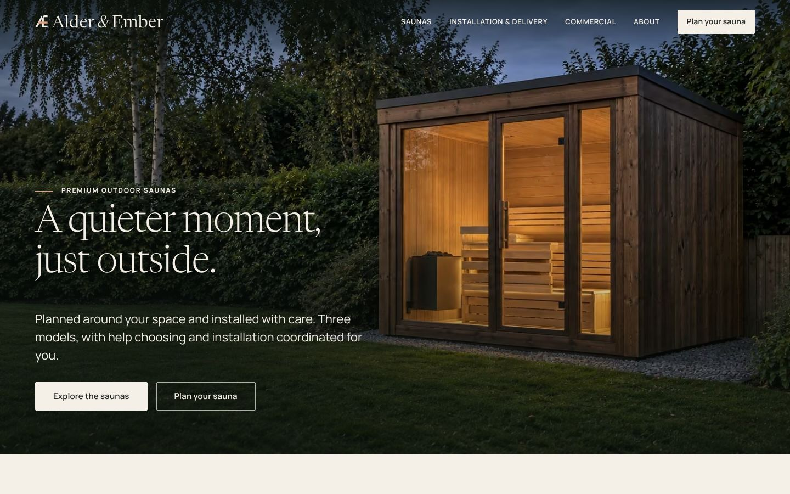

# Alder & Ember

Website and brand system for **Alder & Ember**, a UK supplier and installer of premium outdoor saunas, built to the master brief. The content is final: every value is approved, the photographs are the owner's, and the preview, demo and "working figure" labels are gone. One thing is not connected: **the enquiry forms have no inbox to send to**, so they check the visitor's answers and say plainly that nothing was sent (see [docs/launch-dependencies.md](docs/launch-dependencies.md)).



## What is here

- **Original identity:** logo system (editable SVG), palette, type and tokens. The specimen sheet at `/brand` exists in preview mode only. See [docs/design-system.md](docs/design-system.md).
- **The sitemap:** home, collection, three model pages from one product source, compare, installation & delivery, commercial, about, care & support, planning guides, a model campaign page, plan your sauna, privacy notice, website terms, 404.
- **Signature component, the model explorer:** a stable-ratio stage, a rail of all three models and a concise panel on the home page, driven by the same product records as every other page. Around it, a materials chapter and a planning sequence that follow native scroll and have equivalent controls.
- **Compare and a shortlist selector:** shareable compare URLs, a labelled narrow-screen layout, and a selector that never claims a model "fits" or approves a site.
- **Enquiry journey:** residential and commercial forms, shared client/server validation, an honest not-sent result until an inbox is connected, a durable outbox and a HubSpot adapter.
- **Content integrity built in:** every fact carries an approval status, and a value that was never supplied stays empty and is described as confirmed in the quotation or the site review. One spacing scale (0.5rem, then whole rems) is enforced by a test.

## Run it

```bash
npm install
npm run dev                  # http://localhost:4321
npm run build && npm start   # production-style server (static pages + the enquiry API)
```

Node 22+. Copy `.env.example` to `.env` to change modes. No secrets are needed to preview.

| Command | What it does |
|---|---|
| `npm test` | Unit tests: product data, content gating, selector rules, enquiry validation and handler |
| `npm run check` | Type-check Astro, TypeScript and React (`astro check`) |
| `npm run build:production` | Production-mode build (hides unapproved values and routes) |
| `npm run brief` | Rebuilds the downloadable photography brief (PDF and Word) from `docs/photo-brief.md` and `docs/hero-photo-brief.md` (needs pandoc and python-docx) |
| `npm run check:production` | Builds in production mode and fails on any preview, demo, draft or placeholder wording, a removed page that is still linked, a missing link-preview image, or indexing that does not follow the domain |
| `npm run e2e` / `npm run a11y` / `npm run responsive` / `npm run hero` | Browser journey checks / axe accessibility scan / layout sweep at seven widths and 200% text / contrast of the hero copy over the photograph (need a running build: `npm run build && npm run serve`; the enquiry API rate-limits, so restart the server between `e2e` runs) |
| `npm run build:static` | Static, sub-path-safe preview bundle (`STATIC_BASE=/repo-name/` anchors `404.html` for a project-page host) |
| `npm run e2e:static` | Builds a bundle anchored to `/a/b/c/` and tests it from there: styles, islands, native (Ctrl-click) links, nested 404s, the demo form, and that no request escapes the prefix |
| `npm run images` | Rebuilds the photographs (AVIF and WebP at several widths, crops) from `scripts/images/preview-photos.manifest.json`; the owner's originals are in `incoming/` |
| `npm run perf` | Median-of-three Lighthouse runs per page, mobile and desktop, against a running build |
| `npm run crawl` | Crawls a running build for broken links, anchors and assets |
| `npm run contrast` | WCAG contrast check for every text and control pair in the tokens |
| `npm run logo` | Regenerates the logo SVGs and PNG favicons into `public/brand/` |
| `npm run manifest` | Regenerates [docs/asset-manifest.md](docs/asset-manifest.md) |
| `npm run outbox:retry` | Retries delivery of queued enquiries to HubSpot |

## Stack and why

**Astro 7 + React islands + TypeScript.** Pages are prerendered to static HTML, which is what a content-led, indexable site needs, and only the interactive pieces (model showcase, gallery, compare, selector, enquiry form) ship JavaScript. Only `/api/enquiry` runs on the server (`@astrojs/node`). The brief allows a code prototype where no Webflow environment exists; this is **not** an editable Webflow site. [docs/cms-mapping.md](docs/cms-mapping.md) maps every template, collection and interaction to a Webflow build.

## Deploying

`npm run build` produces `dist/client` (static pages) and `dist/server` (the enquiry endpoint). Run it with `npm start` on any Node 22 host behind HTTPS; put `ENQUIRY_*` and `HUBSPOT_*` variables in the host's secret store, never in the repo. A static-only host can serve `dist/client` but cannot run `/api/enquiry`, so use the Node host (or swap in the matching Astro adapter) for the live form. Nothing has been deployed: production deployment needs the agreed environment and authorisation ([docs/launch-dependencies.md](docs/launch-dependencies.md)).

## Hosted site (static bundle)

`npm run build:static` builds `dist-static/`: a fully static copy that works from any URL or sub-path (every link is relative, no server). It is built in production mode. A static host cannot run `/api/enquiry`, so the form there validates for real and then says plainly that nothing was sent; live enquiries need the Node build or a form service ([docs/launch-dependencies.md](docs/launch-dependencies.md)). `npm run e2e:static` builds a bundle anchored to `/a/b/c/` and tests it from there, failing if any request escapes that path.

**GitHub Pages:** `.github/workflows/pages.yml` runs the unit tests, builds the bundle and publishes it to the `gh-pages` branch on every push to `main` (and to the working branch named in the file). One-time setup, which needs repo admin: Settings, Pages, Source "Deploy from a branch", branch `gh-pages`, folder `/ (root)`. The site is live at https://umejrr.github.io/alder-ember/. Every page says `noindex` until a real domain is set as `PUBLIC_SITE_URL`.

## Content modes

`PUBLIC_CONTENT_MODE=production` (the default) shows only approved and brief-supplied values. `preview` additionally shows draft values with a visible preview notice, and exists for staging new content before it is approved (it is also the only mode that builds the `/brand` sheet). Search engines are let in only when the mode is production **and** `PUBLIC_SITE_URL` is set. Details are in [docs/content-editing.md](docs/content-editing.md).

## Handover documents

| Document | Contents |
|---|---|
| [docs/design-system.md](docs/design-system.md) | Tokens, type, layout, components and states, motion, accessibility approach, logo rationale |
| [docs/references.md](docs/references.md) | What was inspected, what was observed, and what is original |
| [docs/content-editing.md](docs/content-editing.md) | The content source, approval statuses, roles, how to change prices and options safely |
| [docs/cms-mapping.md](docs/cms-mapping.md) | Page and template inventory, and the Webflow CMS mapping |
| [docs/integrations.md](docs/integrations.md) | HubSpot, booking, accessories, email, analytics and consent: what is implemented, demo, or awaiting configuration |
| [docs/launch-dependencies.md](docs/launch-dependencies.md) | What must be supplied or decided before launch, with owners |
| [docs/asset-manifest.md](docs/asset-manifest.md) | Image roles, status and the outstanding photography brief |
| [docs/audit-response.md](docs/audit-response.md) | How each finding in the 19 October live audit was addressed, with the evidence, and what remains open |
| [docs/performance.md](docs/performance.md) | Image and script budgets, and lab measurements before and after |
| [docs/test-report.md](docs/test-report.md) | The checks actually run, with outcomes and what could not be verified |
| [docs/screenshots/](docs/screenshots) | Representative desktop and mobile screenshots |

## Not done, on purpose

No public deployment, live CRM writes, live payments or customer emails. No invented reviews, projects, contact details, certifications, manufacturer names, running costs, weights or warm-up times. See [docs/launch-dependencies.md](docs/launch-dependencies.md).
